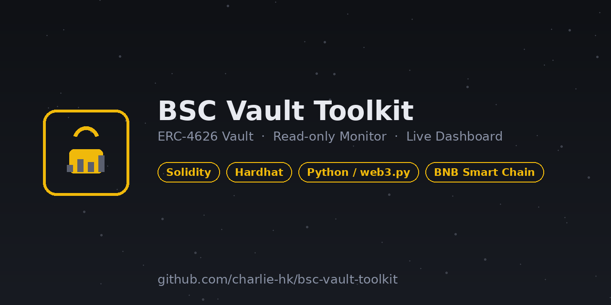

# BSC Vault Toolkit



A small, end-to-end DeFi project on **BNB Smart Chain testnet**: an ERC-4626 vault, a
read-only Python monitor with Telegram alerts, and a static dashboard.

| Part | What it shows |
|---|---|
| `contracts/SimpleVault.sol` | Solidity on OpenZeppelin 5: ERC-4626 vault, deposit cap, emergency pause (withdrawals always stay open), virtual-share protection against the first-depositor inflation attack |
| `test/` | Hardhat tests: cap, pause, ownership, simulated yield, inflation attack |
| `scripts/deploy.js` | Deploys to BSC testnet; refuses any other network |
| `monitor/vault_monitor.py` | web3.py event follower: TVL, share price, cap usage, pause state, Telegram alerts for large deposits/withdrawals |
| `dashboard/` | Zero-dependency HTML dashboard (TVL chart, events table), reads the monitor's JSON |

## Quick start

```bash
# 1. contracts
npm install
npx hardhat test
export DEPLOYER_KEY=<testnet-only private key>
npm run deploy:testnet            # prints the vault address and deploy block

# 2. monitor
cd monitor
pip install -r requirements.txt
cp config.example.json config.json   # set vault_address and start_block
python -m pytest                      # unit tests for the alert logic
python vault_monitor.py               # optional: TELEGRAM_BOT_TOKEN, TELEGRAM_CHAT_ID

# 3. dashboard
cd ../dashboard && python -m http.server 8000   # open http://localhost:8000
```

Without a `data.json` the dashboard shows demo data from `data.sample.json`.

## Design notes

* **Withdrawals are never blocked.** Pause only stops new deposits, so a compromised or
  mistaken owner action cannot trap user funds.
* **Cap is enforced through `maxDeposit`/`maxMint`**, which the ERC-4626 base reverts on,
  so the standard integrations see the real limits.
* **Monitor is read-only.** It holds no keys and sends no transactions.
* **Chunked log queries** keep RPC calls inside public-node limits; RPC errors are logged
  and retried instead of crashing the loop.

## Disclaimer

Educational portfolio code, **testnet only and unaudited**. The monitor is a tool, not
financial advice. Nothing here guarantees profit, and anyone using similar code with real
funds bears all risk of loss.
